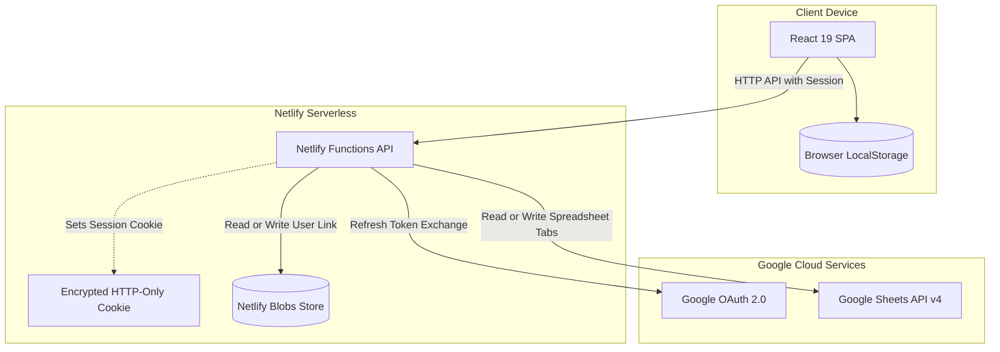
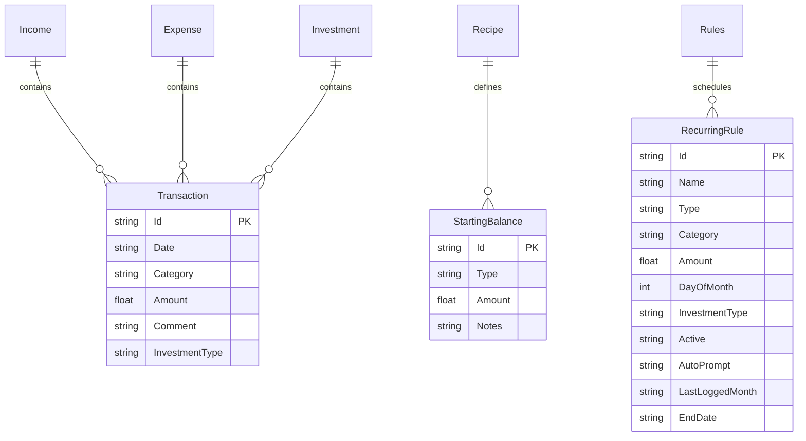
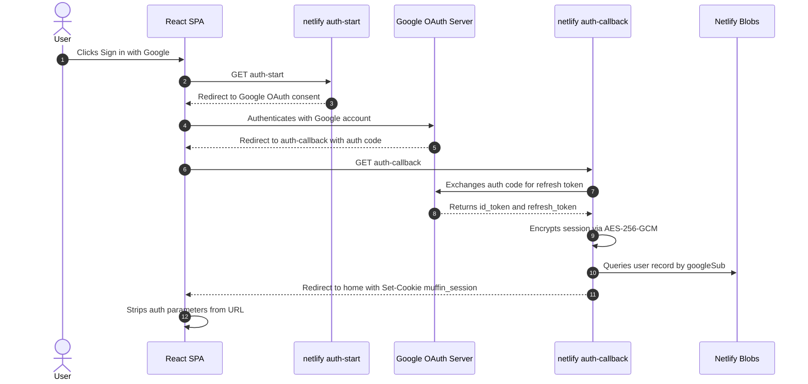

# Muffin — Comprehensive Developer Knowledge Transfer (KT) Document

> **Project Identity**: Muffin is an independently developed personal software application created by **Rahul Gouri**. It is an independent developer project, NOT an enterprise or corporate organization. All documentation, privacy considerations, and terms reflect this independent developer identity.

---

## Table of Contents

1. [Executive Summary & Core Philosophy](#1-executive-summary--core-philosophy)
2. [High-Level Architecture & Data Flow](#2-high-level-architecture--data-flow)
3. [Repository Directory Structure](#3-repository-directory-structure)
4. [Data Model & Google Sheets Schema](#4-data-model--google-sheets-schema)
5. [Authentication, Security & Session Management](#5-authentication-security--session-management)
6. [Backend Serverless Functions (`netlify/`)](#6-backend-serverless-functions-netlify)
7. [Frontend Architecture & Component Hierarchy (`src/`)](#7-frontend-architecture--component-hierarchy-src)
8. [Feature Deep-Dives](#8-feature-deep-dives)
   - [8.1 Home Dashboard & Scoped MonthPicker](#81-home-dashboard--scoped-monthpicker)
   - [8.2 Ledger, Timeline & Transaction Lifecycle](#82-ledger-timeline--transaction-lifecycle)
   - [8.3 Insights Hub (Trends, Categories, Dual-Mode Planner)](#83-insights-hub-trends-categories-dual-mode-planner)
   - [8.4 Recurring Automation & SIP Engine](#84-recurring-automation--sip-engine)
   - [8.5 Settings, Appearance & Data Privacy](#85-settings-appearance--data-privacy)
9. [Financial Metrics Engine (`src/domain/metrics.ts`)](#9-financial-metrics-engine-srcdomainmetricsts)
10. [State Management & Custom Hooks Catalog (`src/hooks/`)](#10-state-management--custom-hooks-catalog-srchooks)
11. [Design System, Theming & Typography](#11-design-system-theming--typography)
12. [Mobile PWA & Capacitor Android Build](#12-mobile-pwa--capacitor-android-build)
13. [Local Development Setup & Environment Variables](#13-local-development-setup--environment-variables)
14. [Deployment, CI/CD & Production Operations](#14-deployment-cicd--production-operations)
15. [Developer Gotchas & Troubleshooting Guide](#15-developer-gotchas--troubleshooting-guide)

---

## 1. Executive Summary & Core Philosophy

**Muffin** is a mobile-first, personal finance Progressive Web App (PWA) with native Android packaging that transforms a user's private Google Spreadsheet into a reactive, fintech-grade financial dashboard.

### Core Architectural Principles

1. **Zero-Database Financial Privacy**:
   - The user's Google Sheet is the **single source of truth** for all transactions, starting balances, and recurring rules.
   - No financial data (income, expenses, balances, net worth) is ever saved to central application databases.
   - Netlify Blobs is used strictly as a lightweight key-value store for mapping a Google User ID (`sub`) to their linked `spreadsheetId` and onboarding flags.

2. **Server-Side Credential Isolation**:
   - Client-side code never possesses Google OAuth Client Secrets or raw refresh tokens.
   - A thin serverless backend (`netlify/functions/`) mediates all interactions with the Google Sheets API using refresh tokens sealed inside tamper-proof, encrypted HTTP-only session cookies.

3. **Predictable Offline/Online Simulation (Planner)**:
   - What-if scenario planning runs entirely client-side in browser storage (`localStorage`) without mutating the real Google Sheet.

4. **Human-Readable Spreadsheets**:
   - The user can view, edit, or audit their data directly inside Google Sheets on web or mobile without breaking the application.

---

## 2. High-Level Architecture & Data Flow



### End-to-End Request Flow

1. **Session Boot**: On load, `useAuthSession` invokes `GET /.netlify/functions/auth-me`.
2. **Session Verification**: The server extracts the `muffin_session` cookie, decrypts the payload via AES-256-GCM using `SESSION_SECRET`, and extracts the Google user identity (`sub`) and OAuth refresh token.
3. **Data Hydration**: The app calls `GET /.netlify/functions/transactions`. The function uses `google-auth-library` and `google-spreadsheet` to read rows from the user's `Income`, `Expense`, and `Investment` tabs, returning typed `Transaction[]`.
4. **Client-Side Derivation**: `App.tsx` feeds `sheetTransactions` and `recipeConfig` into `buildFinancialMetrics()`, which reactively computes Net Worth, monthly KPIs, savings rate, and category distributions without server roundtrips.
5. **Mutations**: Adding, editing, or deleting entries sends `POST`, `PUT`, or `DELETE` requests to `/.netlify/functions/transactions`. The server applies mutations to the spreadsheet row and returns the updated transaction array in a single response.

---

## 3. Repository Directory Structure

```text
MuffinPWA/
├── .agents/                    # Agent instructions & behavioral guidelines
├── android/                    # Capacitor Android Studio native project
├── docs/                       # Project documentation & showcase assets
├── netlify/
│   ├── functions/              # TypeScript Netlify Serverless Functions (v1)
│   │   ├── auth-callback.ts    # OAuth2 redirect handler & cookie issuer
│   │   ├── auth-logout.ts      # Session cookie invalidator
│   │   ├── auth-me.ts          # Session validator & profile provider
│   │   ├── auth-start.ts       # OAuth2 consent URL generator & redirect
│   │   ├── health.ts           # Token freshness probe (visibility health check)
│   │   ├── recipe.ts           # Read / write Starting Balances to Recipe tab
│   │   ├── sheet-create.ts     # Create a bootstrapped 5-tab Google Sheet
│   │   ├── sheet-link.ts       # Link an existing spreadsheet URL / ID
│   │   ├── sheet-unlink.ts     # Unlink sheet from Netlify Blobs
│   │   ├── tour-complete.ts    # Persist first-run tour completion
│   │   └── transactions.ts     # CRUD controller for sheet transaction rows
│   └── lib/                    # Backend utility modules
│       ├── env.ts              # Type-safe environment variable access
│       ├── googleAuth.ts       # OAuth2 client factory & token exchange
│       ├── handler.ts          # withSession middleware wrapper
│       ├── http.ts             # Standardized JSON response helpers
│       ├── recipeStore.ts      # Recipe & Rules tab reader/writer
│       ├── session.ts          # AES-256-GCM cookie sealing/unsealing
│       ├── sheetBootstrap.ts   # Sheet creation, validation & tab provisioner
│       ├── types.ts            # Netlify Lambda request/response types
│       └── userStore.ts        # Netlify Blobs 'muffin-users' store interface
├── public/                     # Static web assets & legal policies
│   ├── icons/                  # Web app manifest icons (192, 512, maskable)
│   ├── privacy.html            # Public Privacy Policy (Google OAuth compliant)
│   ├── terms.html              # Public Terms of Service
│   └── _redirects              # Netlify SPA routing rewrite rules
├── scripts/                    # Build, showcase capture, and icon generators
├── shared/                     # Shared TypeScript domain (used by client & server)
│   ├── dates.ts                # Date parsing, normalization & ISO conversions
│   ├── index.ts                # Barrel export for shared types & utilities
│   ├── recipe.ts               # Recipe sanitization & default factories
│   ├── sheets.ts               # Tab constants, column headers & row serializers
│   └── types.ts                # Core shared DTOs (Transaction, Recipe, Recurring)
├── src/                        # Client-side React 19 Application
│   ├── api/                    # API client layer (typed fetch wrappers)
│   │   └── client.ts           # Client endpoints for all Netlify functions
│   ├── components/             # Reusable atomic UI components
│   │   ├── atoms/              # FocusTrap, Skeleton, SkeletonKpiGrid
│   │   ├── molecules/          # EmptyState, RecurringDueBanner, TransactionForm
│   │   └── ui/                 # SoftButton, FloatingNav, LoadingScreen, MuffinIcon, Toast
│   ├── domain/                 # Pure domain logic (zero UI dependencies)
│   │   ├── evaluateAmount.ts   # Math expression evaluator (+, -, *, /, %, ^)
│   │   ├── metrics.ts          # Core financial calculation engine & KPIs
│   │   ├── parseSheet.ts       # Raw row parser & fingerprint generator
│   │   ├── providentFund.ts    # PF exclusion detection & sum helpers
│   │   ├── recurring.ts        # Month-end clamping & recurrence schedule calculations
│   │   └── types.ts            # UI-specific domain types & MetricKey unions
│   ├── features/               # Feature-based view modules
│   │   ├── auth/               # SignInScreen, SheetOnboarding
│   │   ├── home/               # HomeView, KpiCard, MonthPicker, ChartModal, TransactionList
│   │   ├── insights/           # InsightsView (Trends, Categories, Planner sub-views)
│   │   ├── ledger/             # LedgerView, ManageTransactionModal, SmartAmountInput
│   │   ├── monthly/            # Historical monthly summary view
│   │   ├── planner/            # Standalone what-if financial sandbox
│   │   └── settings/           # SettingsView, Modals (Recipe, Recurring, Theme, Font, Tour)
│   ├── hooks/                  # Custom React hooks (state & lifecycle management)
│   ├── lib/                    # Client libraries (themes, fonts, motion, capacitor)
│   ├── App.tsx                 # Main layout shell, modal host, and tab switcher
│   ├── config.ts               # Currency formatting & Recipe localStorage cache
│   ├── index.css               # Tailwind directives & CSS theme tokens
│   └── main.tsx                # App entrypoint & context provider tree
├── templates/                  # Seed CSV templates for sheet tabs
├── capacitor.config.ts         # Android native wrapper configuration
├── netlify.toml                # Netlify build, redirect, and function configurations
├── package.json                # Dependencies, scripts, and engine versions
├── tailwind.config.js          # Tailwind CSS theme extension & design tokens
├── tsconfig.json               # TypeScript base compiler configuration
└── vite.config.ts              # Vite 6 + React + PWA plugin setup
```

---

## 4. Data Model & Google Sheets Schema

A user's Google Sheet workbook consists of **5 dedicated tabs**.



### 1. `Income` Tab
- **Headers**: `Id`, `Date`, `Category`, `Amount`, `Comment`
- **Semantics**: Inflows of liquid cash (Salary, Freelance, Dividends).

### 2. `Expense` Tab
- **Headers**: `Id`, `Date`, `Category`, `Amount`, `Comment`
- **Semantics**: Outflows of liquid cash (Groceries, Utilities, Rent).

### 3. `Investment` Tab
- **Headers**: `Id`, `Date`, `Category`, `Amount`, `Investment Type`, `Comment`
- **Semantics**: Capital allocation (SIP, Stocks, Gold, Mutual Funds).
  - Positive numbers indicate purchases (reduces liquid cash, increases investments).
  - Negative numbers indicate redemptions (increases liquid cash, decreases investments).
  - **Provident Fund Handling**: If `Investment Type` or `Category` matches `PF`, `EPF`, `PPF`, or `Provident Fund`, the row is treated as display-only: excluded from Net Worth, liquid balance, and investment aggregates.

### 4. `Recipe` Tab (Starting Balances)
- **Headers**: `Type`, `Amount`, `Id`, `Notes`
- **Row 1**: `Opening Balance` (`Id: opening_balance`) — Cash in bank prior to tracked sheet history.
- **Subsequent Rows**: Assets held prior to tracked history (e.g., `Fixed Deposit`, `Mutual Funds`).

### 5. `Rules` Tab (Recurring Automation)
- **Headers**: `Id`, `Name`, `Type`, `Category`, `Amount`, `DayOfMonth`, `InvestmentType`, `Comment`, `Active`, `AutoPrompt`, `LastLoggedMonth`, `EndDate`, `CreatedAt`
- **Semantics**: Monthly recurring transactions (SIPs, bills, salaries).

### Row Identification & Mutation Safety
- App-created workbooks include a unique `Id` column generated via `newRowId()` (`mfn_<timestamp>_<random>`).
- If an older or user-created sheet lacks the `Id` column, the backend falls back to an `expectedRow` fingerprint: `{ date, category, amount }` combined with `rowIndex`. If the row at `rowIndex` does not match the fingerprint, the mutation is aborted with a `409 Conflict` to prevent overwriting shifted data.

---

## 5. Authentication, Security & Session Management

Muffin uses an **OAuth 2.0 Web Application** model with Google Cloud Identity.



### Encryption & Session Cookie Details (`netlify/lib/session.ts`)
- **Cookie Name**: `muffin_session`
- **TTL**: 30 Days (`SESSION_TTL_MS = 2,592,000,000`)
- **Flags**: `HttpOnly; Path=/; SameSite=Lax; Secure` (Secure omitted on localhost).
- **Algorithm**: `AES-256-GCM` authenticated symmetric encryption.
  - Encryption key is derived via `SHA-256(SESSION_SECRET)`.
  - A unique 12-byte initialization vector (`iv`) is generated per token using `crypto.randomBytes(12)`.
  - The encrypted string format is `base64url(iv + authTag + cipherText)`.
- **Payload Contents**:
  ```typescript
  interface SessionPayload {
    sub: string;          // Google User Subject ID
    email: string;        // Google Email
    name: string;         // Full Name
    picture: string;      // Profile Avatar URL
    refreshToken: string; // Long-lived Google Refresh Token
    exp: number;          // Expiration epoch timestamp
  }
  ```

### Session Health & Refresh Token Expiration
- Tokens can be revoked by the user or expired by Google (e.g., test app status 7-day limit).
- The client probes `/.netlify/functions/health` via `useAuthSession` when the browser tab gains visibility (`visibilitychange` or `focus`) after 30 seconds away.
- When an API call returns `invalid_grant`, the backend raises an `AuthRequiredError` (401), prompting the UI to show an expiration notice and route to sign-in.

---

## 6. Backend Serverless Functions (`netlify/`)

All backend logic runs in Netlify Serverless Functions (AWS Lambda runtime under Node.js 18+).

| Function Route | Method | Handler / Middleware | Description |
|---|---|---|---|
| `auth-start` | `GET` | Plain Handler | Generates Google OAuth URL with state CSRF protection and redirects the browser. |
| `auth-callback` | `GET` | Plain Handler | Handles redirect from Google, exchanges auth code for refresh token, creates encrypted cookie, and redirects to `/`. |
| `auth-me` | `GET` | `withSession` | Returns the current user profile, linked spreadsheet info, and tour completion status. |
| `auth-logout` | `POST` | `withSession` | Clears the `muffin_session` cookie (`Max-Age=0`). |
| `health` | `GET` | `withSession` | Validates session freshness by testing access token retrieval against Google OAuth. |
| `sheet-link` | `POST` | `withSession` | Validates that a user-supplied Sheet ID exists and has the required tabs, then saves it to Netlify Blobs. |
| `sheet-create` | `POST` | `withSession` | Uses `google-spreadsheet` to create a new sheet in the user's Google Drive, bootstraps all 5 tabs with headers, and links it. |
| `sheet-unlink` | `POST` | `withSession` | Removes the `spreadsheetId` mapping from Netlify Blobs. |
| `recipe` | `GET`, `PUT` | `withSession` | `GET` reads starting balances and rules from the `Recipe`/`Rules` tabs. `PUT` serializes and rewrites both tabs. |
| `tour-complete` | `POST` | `withSession` | Sets `tourCompletedAt` in Netlify Blobs so the guided tour is not shown again. |
| `transactions` | `GET`, `POST`, `PUT`, `DELETE` | `withSession` | Full CRUD controller for transactions across `Income`, `Expense`, and `Investment` tabs. Returns updated transactions on write. |

### Middleware Architecture (`netlify/lib/handler.ts`)
The `withSession` wrapper provides automatic session validation, error normalization, and CORS handling:

```typescript
export function withSession(handler: AuthenticatedHandler): NetlifyHandler {
  return async (event, context) => {
    bindBlobsEvent(event); // Connect Netlify Blobs context
    try {
      const session = requireSession(event); // Throws 401 if missing/invalid
      return await handler(event, context, session);
    } catch (err) {
      return jsonErrorResponse(err); // Maps AuthRequiredError to 401, etc.
    }
  };
}
```

---

## 7. Frontend Architecture & Component Hierarchy (`src/`)

### High-Level Component Tree

```text
main.tsx (Root Provider Tree)
├── ThemeProvider (data-theme, status bar sync, CSS variables)
├── FontProvider (data-font, font-family CSS variables)
├── MaskProvider (valuesMasked toggle, currency masking)
└── RecipeProvider (in-memory & localStorage starting balances)
    └── App.tsx (Main Application Controller)
        ├── ToastNotification (Global floating toasts with Undo action)
        ├── HeaderMenu (Avatar trigger, user profile popover, Logout)
        ├── Modals Host (Controlled via useAppModals)
        │   ├── ManageTransactionModal (Add / Edit transaction form)
        │   ├── ConfirmModal (Destructive delete / unlink confirmations)
        │   ├── RecipeModal (Starting Balances configuration)
        │   ├── RecurringManagerModal (Rules management & scheduling)
        │   ├── TourModal (First-run onboarding walkthrough)
        │   ├── ThemeModal / FontModal (Visual customizations)
        │   └── PrivacyModal / TermsModal / UserGuideModal
        ├── Main Viewport (Animated tab transitions via Framer Motion)
        │   ├── HomeView (activeTab === 'home')
        │   ├── InsightsView (activeTab === 'insights')
        │   ├── LedgerView (activeTab === 'ledger')
        │   └── SettingsView (activeTab === 'settings')
        └── FloatingNav (Bottom frosted glass navigation capsule with '+' FAB)
```

### Application State Architecture
Muffin avoids monolithic state libraries (Redux, Zustand) in favor of specialized custom hooks managing bounded contexts:
- **`useAuthSession`**: Authentication state, session bootstrapping, and visibility probing.
- **`useSheetTransactions`**: Server transactions fetching, mutation operations, and undo stack.
- **`useRecipeConfig`**: Starting balances and recurring rules subscribed from `src/config.ts`.
- **`useRecurringAutomation`**: Automation engine calculating due rules and batch-logging entries.
- **`usePlannerStore`**: In-memory simulation transactions persisted in `localStorage`.
- **`useAppModals`**: Discriminated union manager ensuring only one active modal is mounted at a time.

---

## 8. Feature Deep-Dives

### 8.1 Home Dashboard & Scoped MonthPicker

The **Home** view displays high-level financial health:
1. **Net Worth & Balances**: Hero card showing combined Net Worth (`liquidBalance + investmentBalance`), dual progress bar (Liquid vs Invested ratio), and Provident Fund total.
2. **Month Overview (Scoped by MonthPicker)**:
   - Cards: **Month Income**, **Month Expense** (with % of income progress bar), and **Month Savings & Allocation**.
   - **`MonthPicker` Component**:
     - Allows selecting any recorded month/year via native `<select>` dropdowns.
     - Includes `<` (prev) and `>` (next) stepper buttons.
     - **Dynamic Badges**:
       - Current month: Header shows `"This Month"` without badges.
       - Past month: Header shows month label (e.g., `"October 2026"`) with an amber `"Historical"` badge.
       - Future month: Header shows month label (e.g., `"December 2026"`) with a sky-blue `"Upcoming"` badge.
     - **Quick Snap Back**: When viewing non-current months, a `"Current Month"` button with `RotateCcw` icon is visible to return in one tap.
3. **Investments & Allocation**: Shows top 3 investment categories by percentage and amount. Tapping opens the full distribution pie chart.
4. **Lifetime Totals & Growth**: Cumulative income, spends, net savings, rupees growth, percentage growth, and average monthly savings.
5. **Interactive Drill-Downs (`ChartModal`)**:
   - Tapping Month Income, Month Expense, or Month Investment opens a list of transactions filtered to the currently active month.
   - Tapping Net Worth, Liquid, or Average Savings renders interactive trendline graphs with time-range filtering (`3M`, `6M`, `1Y`, `ALL`).

---

### 8.2 Ledger, Timeline & Transaction Lifecycle

The **Ledger** (`src/features/ledger/LedgerView.tsx`) is a date-grouped chronological transaction list:
- **Smart Grouping**: Grouped by relative headers (`"Today"`, `"Yesterday"`, or formatted date like `"Mon, 10 Nov 2026"`), each displaying daily net total.
- **Category Iconography**: Matches category names to domain icons (e.g., `ShoppingBag` for shopping, `Utensils` for dining, `TrendingUp` for investments).
- **Search & Filters**: Full-text search across categories, comments, and amounts, with quick filters by transaction type and date range.
- **Allowance Deduction**: When adding an expense, checking `"Deduct from Allowance - Self"` automatically finds the current month's allowance entry and reduces it by the entered amount.
- **Redemption P&L**: When logging an investment redemption (negative amount), the form can automatically record a linked capital profit or loss entry on the `Investment` or `Expense` tab.
- **Undo Delete Action**: Deleting an item removes it from the sheet immediately, triggers a subtle haptic vibration (`navigator.vibrate(8)`), and shows an 8-second toast with an **Undo** button that recreates the exact row if tapped.

---

### 8.3 Insights Hub (Trends, Categories, Dual-Mode Planner)

The **Insights** tab (`src/features/insights/InsightsView.tsx`) organizes deep analysis into 3 sub-tabs:

1. **Trends**: Month-over-month bar charts comparing Income vs Spending. Clicking any month bar switches directly to the Ledger filtered to that month.
2. **Categories**: Donut chart with category spending distribution, category list with percentages, and Month-over-Month (MoM) delta badges (`+12% vs last month`).
3. **Planner (Dual Simulation Modes)**:
   - An interactive financial sandbox to simulate scenarios ("What if I buy a car?", "What if my rent increases?").
   - **Mode 1: Current Month**: Loads real Google Sheet transactions for the active month, allowing you to layer staged transactions on top to view projected closing liquid cash and savings rate.
   - **Mode 2: Blank Canvas**: Completely empty in-memory ledger with zero real sheet data, allowing arbitrary budget modeling from scratch.
   - Staged entries are stored strictly in browser `localStorage` and never written to Google Sheets.

---

### 8.4 Recurring Automation & SIP Engine

Located in `src/domain/recurring.ts` and `src/hooks/useRecurringAutomation.ts`:
- **Storage**: Persisted directly on the `Rules` tab of the user's Google Sheet.
- **Smart Month-End Clamping**: Rules scheduled for the 31st automatically clamp to the last valid day of the month (e.g., Feb 28/29, Apr 30) via `getEffectiveDueDay()`.
- **Due Detection**: Compares `dayOfMonth` against `refDate.getDate()`. If due and not yet logged for the current `YYYY-MM` cycle (`lastLoggedMonth !== currentMonthKey`), it surfaces on the **RecurringDueBanner**.
- **1-Tap Batch Logging**: Clicking `"Log All Due"` logs all pending recurring items as real sheet transactions in one atomic batch and updates `lastLoggedMonth` on the rule.

---

### 8.5 Settings, Appearance & Data Privacy

The **Settings** view (`src/features/settings/SettingsView.tsx`) controls client preferences and account bindings:
- **Account Card**: Displays Google user photo, name, email, linked Google Sheet ID (with 1-click clipboard copy), and a button to open the spreadsheet directly in Google Sheets.
- **Appearance**:
  - **12 Muffin Themes**: 6 Light (`Classic`, `Blueberry`, `Pistachio`, `Lavender`, `Velvet Light`, `Pure Light`) and 6 Dark (`Double Chocolate`, `Midnight`, `Emerald`, `Lavender Dark`, `Red Velvet`, `Obsidian Dark`).
  - **7 Display Fonts**: `Muffin (Default)`, `Josefin — Elegant`, `Fredoka — Playful`, `Exo 2 — Futuristic`, `Atkinson — Clear`, `Syne — Bold`, `Bricolage — Quirky`.
- **Data & Privacy**:
  - **Mask Amounts**: Toggles client-side masking (`••••••`) across all cards, lists, and charts for privacy in public spaces.
  - **Starting Balances (Recipe)**: Configures opening cash and pre-existing investments, synced to the sheet's `Recipe` tab.
- **Legal & Help**: Replays the first-run tour, links to the user guide, and renders the in-app Privacy Policy and Terms of Service.

---

## 9. Financial Metrics Engine (`src/domain/metrics.ts`)

The metrics engine is **pure and deterministic**. It receives an array of transactions, recipe starting configurations, and an optional target month.

### Mathematical Formulations

$$\text{investmentBalance} = \text{initialInvestments} + \sum \text{countedInvestment}$$

$$\text{trackedLiquid} = \sum \text{income} - \sum \text{expense} - \sum \text{countedInvestment}$$

$$\text{liquidBalance} = \text{openingBalance} + \text{trackedLiquid}$$

$$\text{netWorth} = \text{liquidBalance} + \text{investmentBalance}$$

$$\text{providentFundBalance} = \sum \text{PF rows}$$

$$\text{growthSinceStart} = \text{netWorth} - (\text{openingBalance} + \text{initialInvestments})$$

$$\text{growthSinceStartPct} = \frac{\text{growthSinceStart}}{|\text{openingBalance} + \text{initialInvestments}|} \times 100$$

### Monthly Aggregates (Scoped to `selectedMonth`)

For the selected month (defaulting to current calendar month `YYYY-MM`):

$$\text{currentMonthLiquid} = \text{currentMonthIncome} - \text{currentMonthExpense} - \text{currentMonthInvestment}$$

$$\text{savingsRate} = \frac{\text{currentMonthInvestment} + \text{currentMonthLiquid}}{\text{currentMonthIncome}} \times 100$$

### Rolling Closing Liquid Calculation (`buildMonthlyKPIs`)
Iterates chronologically through all historical months, maintaining a rolling accumulator:

$$\text{closingLiquid}_m = \text{closingLiquid}_{m-1} + (\text{income}_m - \text{expense}_m - \text{investment}_m)$$

Where $\text{closingLiquid}_0 = \text{openingBalance}$.

---

## 10. State Management & Custom Hooks Catalog (`src/hooks/`)

| Hook | File | Primary Responsibility | Key Exposed API |
|---|---|---|---|
| `useAuthSession` | `useAuthSession.ts` | Authenticates user, probes session health, handles logout, strips URL query parameters. | `auth`, `ready`, `authBooting`, `statusMessage`, `refreshAuth()`, `handleLogout()` |
| `useSheetTransactions` | `useSheetTransactions.ts` | Fetches transactions from backend, handles optimistic updates, and manages Undo delete stack. | `sheetTransactions`, `ledgerTransactions`, `loading`, `mutating`, `executeDelete()`, `refreshTransactions()` |
| `useRecipeConfig` | `useRecipeConfig.tsx` | Provides reactive access to starting balances and recurring rules from `src/config.ts`. | `config`, `updateConfig()`, `saveConfigToBackend()` |
| `useRecurringAutomation`| `useRecurringAutomation.ts`| Evaluates due/upcoming recurring rules, provides batch logging logic, and controls banner dismissal. | `dueSummary`, `showBanner`, `logAllDue()`, `logSingleRule()`, `dismissBanner()` |
| `usePlannerStore` | `usePlannerStore.ts` | Manages staged what-if transactions in `localStorage` across Current Month and Blank modes. | `currentMonthPlannerTransactions`, `blankPlannerTransactions`, `handleAddPlanner()`, `handleClearPlanner()` |
| `useAppModals` | `useAppModals.ts` | Discriminated union modal manager ensuring clean mount/unmount lifecycles. | `modal`, `openModal(kind)`, `closeModal()`, `isOpen(kind)`, `confirmBusy` |
| `useTheme` | `useTheme.tsx` | Controls the 12 muffin themes, synchronizes Android status bar color, and sets `data-theme`. | `themeId`, `theme`, `setThemeId()`, `toggleTheme()` |
| `useFont` | `useFont.tsx` | Controls the 7 typography styles and applies CSS `--font-body` and `--font-display` variables. | `fontId`, `font`, `setFontId()` |
| `useMask` | `useMask.tsx` | Controls amount privacy masking (`••••••`) and provides masked currency formatting helpers. | `masked`, `toggleMask()`, `formatCurrency()`, `formatSignedCurrency()` |
| `usePullToRefresh` | `usePullToRefresh.ts` | Touch event listener enabling smooth pull-to-refresh on mobile browsers. | `containerRef`, `pullDistance`, `refreshing` |
| `usePwaInstall` | `usePwaInstall.tsx` | Captures the browser `beforeinstallprompt` event and provides a 1-tap install trigger. | `isInstallable`, `isInstalled`, `triggerInstall()` |

---

## 11. Design System, Theming & Typography

Muffin uses a bespoke, cozy glassmorphic design system configured via Tailwind CSS tokens.

### Theme Tokens (`src/index.css`)
Each theme sets CSS custom properties on `:root[data-theme='<id>']`:
- `--color-canvas`: Main viewport background.
- `--color-surface`: Standard card and container surface.
- `--color-surface-strong`: High-contrast elements, inputs, and modal sheets.
- `--color-primary`: Brand accent color used for buttons, active pills, and hero cards.
- `--color-text`: Primary typography color.
- `--color-text-secondary`: Supporting typography color.
- `--color-border`: Hairline borders (`border-border`).
- `--shadow-warm`: Soft ambient drop shadow.

### Status Bar Sync (`src/lib/capacitor.ts`)
When the theme changes, `syncStatusBarWithTheme()` is called to set the Android status bar and navigation bar colors to match `--color-canvas` using `@capacitor/status-bar`.

### Motion Tokens (`src/lib/motion.ts`)
All spring animations use consistent Framer Motion physics:
```typescript
export const springSoft = {
  type: 'spring',
  stiffness: 380,
  damping: 30,
};

export const sheetTransition = {
  type: 'spring',
  damping: 28,
  stiffness: 300,
};
```

---

## 12. Mobile PWA & Capacitor Android Build

Muffin operates as both an installable Progressive Web App and a native Android application.

### PWA Configuration (`vite.config.ts`)
- Configured via `vite-plugin-pwa` with `generateSW` strategy.
- Cache rules pre-cache all HTML, CSS, JavaScript, web fonts, and SVGs.
- Service worker registration defaults to `autoUpdate`.

### Android Build via Capacitor (`capacitor.config.ts`)
- **Package ID**: `com.rahulgouri.muffin`
- **App Name**: `Muffin`
- **Web Directory**: `dist`
- **Server URL**: `https://muffin-ledger.netlify.app`
- **Google OAuth User-Agent Fix**:
  Google blocks OAuth requests from embedded WebViews (`disallowed_useragent`). Capacitor overcomes this by overriding the Android user-agent string:
  ```typescript
  android: {
    overrideUserAgent:
      'Mozilla/5.0 (Linux; Android 14; Mobile) AppleWebKit/537.36 (KHTML, like Gecko) Chrome/131.0.0.0 Mobile Safari/537.36',
  }
  ```

### Android Build Commands
```bash
# 1. Compile web assets and sync to native Android project
npm run build:mobile

# 2. Assemble debug APK
npm run build:apk:debug
# Output: android/app/build/outputs/apk/debug/app-debug.apk
```

---

## 13. Local Development Setup & Environment Variables

### Prerequisites
- **Node.js**: v18.0.0 or higher (v20+ recommended).
- **npm**: v9.0.0 or higher.
- **Netlify CLI**: Installed globally or run via `npx netlify-cli`.
- **Google Cloud Console Account**: An active project with Google Sheets API enabled.

### 1. Configure Local Environment (`.env`)
Create a `.env` file in the project root:

```env
# Google OAuth 2.0 Web Client Credentials (obtained from your Google Cloud Console)
GOOGLE_CLIENT_ID=<YOUR_GOOGLE_CLIENT_ID>.apps.googleusercontent.com
GOOGLE_CLIENT_SECRET=<YOUR_GOOGLE_CLIENT_SECRET>

# Authorized redirect URI for local development
GOOGLE_REDIRECT_URI=http://localhost:8888/.netlify/functions/auth-callback

# 32+ character random string for AES-256 session cookie encryption (e.g. `openssl rand -hex 32`)
SESSION_SECRET=<YOUR_RANDOM_SESSION_SECRET>

# Optional client API Base URL (leave empty in local dev to use relative proxy)
VITE_API_BASE_URL=
```

### 2. Configure Google Cloud Console
1. Open [Google Cloud Console](https://console.cloud.google.com).
2. Enable the **Google Sheets API**.
3. In **OAuth Consent Screen**:
   - User Type: **External**
   - Scopes: `openid`, `email`, `profile`, `https://www.googleapis.com/auth/spreadsheets`
   - Test Users: Add your personal Google email address while app is in testing status.
4. In **Credentials** -> **OAuth 2.0 Client IDs** (Web Application):
   - Authorized JavaScript Origins: `http://localhost:8888`
   - Authorized Redirect URIs: `http://localhost:8888/.netlify/functions/auth-callback`

### 3. Launch the Development Server
Always run with `npm run dev` (which launches **Netlify Dev**), NOT plain `vite`:

```bash
npm install
npm run dev
```

Netlify Dev starts Vite and provisions the serverless functions at `http://localhost:8888`.

---

## 14. Deployment, CI/CD & Production Operations

### Production Environment Variables in Netlify
Configure these in **Netlify Site Configuration** -> **Environment Variables**:

| Variable | Description / Value Format |
|---|---|
| `GOOGLE_CLIENT_ID` | `<YOUR_GOOGLE_CLIENT_ID>.apps.googleusercontent.com` |
| `GOOGLE_CLIENT_SECRET` | `<YOUR_GOOGLE_CLIENT_SECRET>` |
| `GOOGLE_REDIRECT_URI` | `https://<YOUR_SITE_NAME>.netlify.app/.netlify/functions/auth-callback` |
| `SESSION_SECRET` | `<YOUR_RANDOM_32_BYTE_HEX_SECRET>` |

> **Warning**: Ensure `GOOGLE_REDIRECT_URI` in Netlify uses `https://` and points to the live domain. It must be added to the Google Cloud Console's authorized redirect URIs list.

### Build & Deploy Pipeline (`netlify.toml`)
```toml
[build]
  command = "npm run build"
  publish = "dist"
  functions = "netlify/functions"

[functions]
  node_bundler = "esbuild"

[[redirects]]
  from = "/*"
  to = "/index.html"
  status = 200
```

---

## 15. Developer Gotchas & Troubleshooting Guide

### 1. Windows CRLF Line Endings
- **Issue**: Automated edits with `edit_file` can fail if file content uses `\r\n` while replacement strings use `\n`.
- **Fix**: Use single-line replacements or normalize line endings before programmatic edits.

### 2. `disallowed_useragent` on Android WebView
- **Issue**: Google blocks OAuth sign-ins inside Android WebViews for security.
- **Fix**: Verify `capacitor.config.ts` has `overrideUserAgent` set to a standard mobile Chrome browser string.

### 3. "Netlify Blobs Unavailable" in Local Dev
- **Issue**: Running plain `vite` instead of `netlify dev` means Netlify Blobs context is absent.
- **Fix**: `netlify/lib/userStore.ts` automatically falls back to `.netlify/muffin-users/` on disk when running locally, but you must launch using `npm run dev` (`netlify dev`).

### 4. Sheet Tab Names Must Match Exactly
- **Issue**: Adding transactions fails with `"Tab not found"`.
- **Fix**: Tab names in Google Sheets must be exact: `Income`, `Expense`, `Investment`, `Recipe`, and `Rules` (case-sensitive, no leading/trailing spaces).

### 5. `invalid_grant` Token Revocation
- **Issue**: API calls return 401 with `invalid_grant` error.
- **Cause**: While the Google OAuth app is in "Testing" mode, refresh tokens expire every 7 days.
- **Fix**: Log out and re-authenticate via Google. For permanent tokens, move the OAuth app to "In Production" in Google Cloud Console.

### 6. Excel/CSV Formula Characters in Amount
- **Issue**: Amounts fail to parse or evaluate to NaN.
- **Fix**: The app uses `src/domain/evaluateAmount.ts` to parse arithmetic. Comma separators (e.g. `1,50,000`) and currency symbols (`₹`) are stripped before parsing. Raw spreadsheet cells should ideally store numeric values without currency symbols.

---

*Document compiled and maintained for Muffin by Rahul Gouri.*

